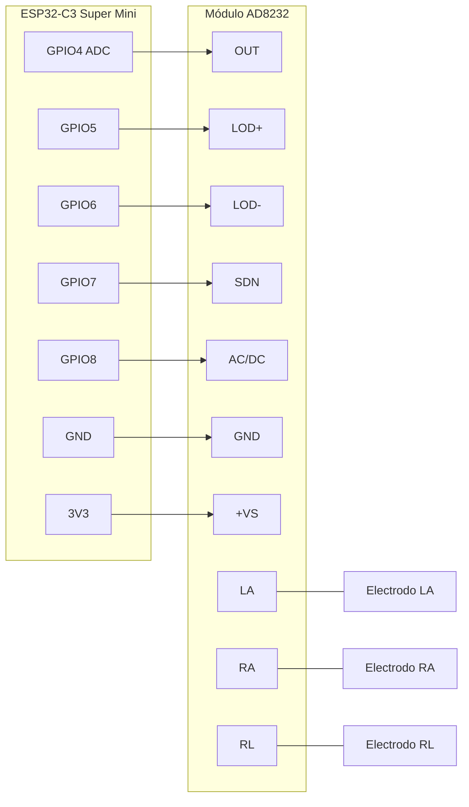

# Cableado — ESP32-C3 Super Mini + AD8232 (Binghe)

## Diagrama

## Tabla de conexiones (por defecto)

| AD8232 | ESP32-C3 | Notas |
| --- | --- | --- |
| **+VS** | **3V3** | Alimentar a **3,3 V** (no 5 V si no necesitas más rango; ADC más estable) |
| **GND** | **GND** | Estrella común con electrodos |
| **OUT** | **GPIO4** | Señal condicionada → ADC1 |
| **LOD+** | **GPIO5** | `INPUT`, pull no necesario; **HIGH** = desconexión |
| **LOD-** | **GPIO6** | Igual |
| **SDN** | **GPIO7** | `OUTPUT` **HIGH** = chip activo |
| **AC/DC** | **GPIO8** | `OUTPUT` **LOW** = modo DC habitual en breakouts |
| **LA / RA / RL** | Electrodos | Tornillo/borne del módulo Binghe |

## Electrodos

Referencia clásica de una derivación para performance:

| Etiqueta | Ubicación escénica recomendada |
| --- | --- |
| **LA** (Left Arm) | Muñeca izquierda o bajo clavícula izq. |
| **RA** (Right Arm) | Muñeca derecha |
| **RL** (Right Leg) | Tobillo derecho o cadera (referencia de conductor derecho) |

Para conciertos largos, rota parches adhesivos ECG desechables y lleva repuesto.

## Alimentación y ruido

- Alimenta el ESP32 por **USB directo** al portátil (misma tierra que el audio).  
- Aleja fuentes de 230 V y móviles en la bolsa del pecho si hay interferencia.  
- Si el **LOD** parpadea, reaplica gel conductor en el centro del electrodo.

## Seguridad

- El AD8232 en 3,3 V es de baja energía; **no conectar a TENS ni EMS**.  
- Una persona con marcapasos **no debe usarse** como sujeto de medición en performance.  
- Este montaje **no sustituye** monitorización clínica.